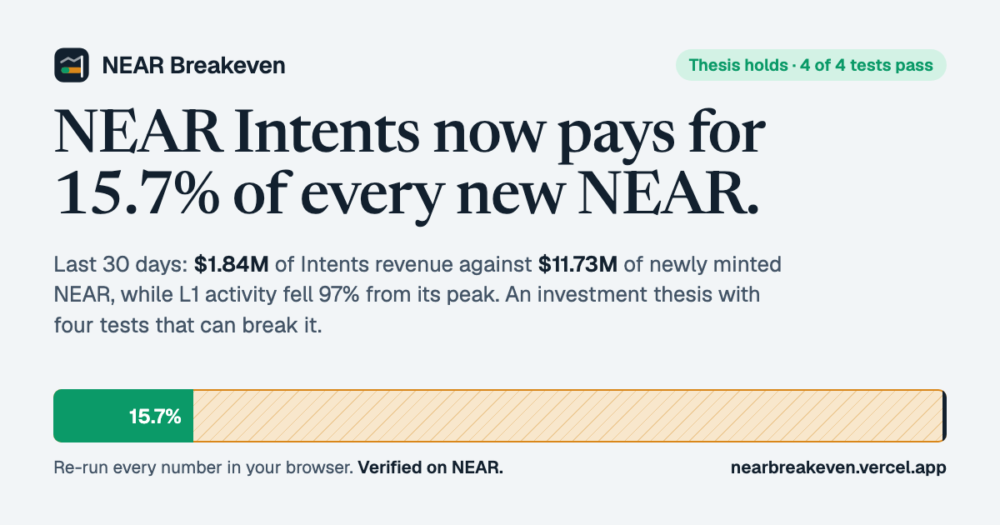
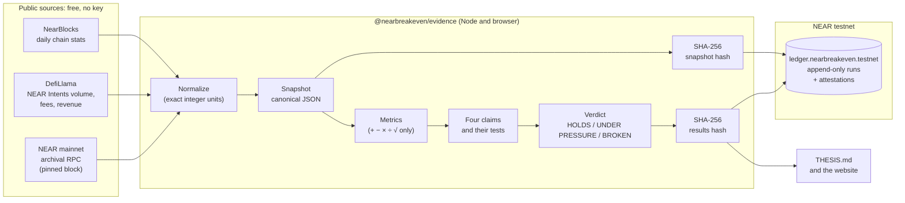

<p align="center">
  
</p>

<p align="center">
  <b>An investment thesis for NEAR that you can rebuild with one command and verify on NEAR itself.</b><br />
  NEAR HACKATHON 2026 · Investment Thesis track
</p>

<p align="center">
  <a href="https://nearbreakeven.vercel.app"><b>Live site</b></a> ·
  <a href="https://nearbreakeven.vercel.app/verify">Re-run it in your browser</a> ·
  <a href="THESIS.md">THESIS.md</a> ·
  <a href="https://testnet.nearblocks.io/address/ledger.nearbreakeven.testnet">Ledger contract</a> ·
  <a href="#demo-video">Demo video</a>
</p>

<p align="center">
  
</p>

---

## The thesis in one minute

**NEAR is becoming a cross-chain toll business, and the toll already pays for 15.7% of every new NEAR.**

Since the July 2024 peak, NEAR's daily active accounts fell **96.8%** and transactions **91.9%**. The usual scoreboard says NEAR is dying. Over the same stretch, NEAR Intents (the layer that settles swaps between chains) became NEAR's main source of revenue, and NEAR uses that revenue to buy NEAR back. The right scoreboard is **coverage**: how much of the dollar value of newly issued NEAR that Intents revenue pays for.

| Last 30 days, data through 12 Nov 2026 | |
|---|---|
| NEAR Intents revenue kept by NEAR | **$1.84M** (4.87 bps of $3.77B volume) |
| Gas paid on the whole NEAR L1 | **$131.5K**, 13.97× less |
| Dollar value of newly issued NEAR | **$11.73M** (2.47% a year, halved in Oct 2025) |
| **Coverage** | **15.7%**, and 18.1% over 90 days against 11.2% the 90 days before |
| Breakeven | Intents volume of **$803.6M a day**, 6.39× today, at today's take rate and price |
| Verdict | **HOLDS**, 4 of 4 tests pass |

Every number above is produced by `pnpm thesis` from three free public sources. The run is anchored on NEAR testnet, and anyone can re-run it and record on chain whether they got the same numbers. Full text with the evidence for and against: **[THESIS.md](THESIS.md)**.

> Research for a hackathon, not investment advice.

## What we found that others miss

1. **The headline metric is broken.** Daily active accounts, the number most NEAR dashboards lead with, fell 97% while NEAR's price rose 279% from its February 2026 low. Over the last 12 months, monthly changes in activity and price have a correlation of **−0.31**. Gas paid per active account rose **6×**, which fits a network that lost airdrop and bot traffic. Activity is the wrong scoreboard.
2. **NEAR's revenue moved off its own chain.** NEAR Intents earns NEAR **14×** more than all L1 gas, and the money comes from swaps between *other* chains. No other L1 has this shape, and no public dashboard tracks it against issuance with tests that can fail.
3. **Most "evidence" in this track cannot be re-run by a judge.** The suggested sources need a Google Cloud bill (BigQuery) or a partner key (Intents Explorer). NEAR Breakeven uses only keyless sources and proves reproducibility *on NEAR*: the snapshot and results hashes of every run are anchored in an append-only contract, and the contract itself checks anyone's re-run.

## Check it in 5 minutes

| Do this | You should see |
|---|---|
| Open **https://nearbreakeven.vercel.app** | The verdict, the coverage tape (15.7%) and a live card reading run #0 from `ledger.nearbreakeven.testnet` |
| Go to **Re-run and verify**, press **Start the re-run** | Your browser fetches NearBlocks, DefiLlama and NEAR's archival RPC, recomputes everything in about 3 s, and shows **Same numbers, to the last byte**: both hashes match the anchored ones |
| (Optional) connect a testnet wallet and press **Record my re-run on NEAR** | A transaction to `attest`; the contract stores `results_matches: true` under your account, and the live feed shows it |
| `git clone https://github.com/Nailer/nearbreakeven && cd nearbreakeven && pnpm install && pnpm verify` | The CLI reads run #0 from NEAR, re-fetches every source at the pinned block, and prints `MATCH` twice |
| `pnpm thesis` | Rebuilds every number for yesterday from raw data, rewrites `THESIS.md`, prints the four tests and the verdict |
| `pnpm test` and `cd contract && cargo test` | 29 TypeScript tests and 10 contract tests pass, including one that reproduces anchored run #0 byte for byte |

No account, API key or wallet is needed for any step except the optional attestation.

## How it works



**1. Pin.** A run picks a day (`asOf`, yesterday in UTC) and a NEAR mainnet block. It fetches the NearBlocks daily series and DefiLlama's NEAR Intents series up to that day, and reads the protocol's inflation parameters, the total supply and the Intents buyback wallet from an archival node *at that block*. Re-reading the same block always returns the same values.

**2. Normalize and hash.** Raw responses become plain rows with exact units (yoctoNEAR is converted with integer arithmetic, dollars are rounded to cents). The snapshot is serialized as canonical JSON (sorted keys, no whitespace) and hashed with SHA-256 through WebCrypto, which gives identical bytes in Node and in every browser.

**3. Compute.** [`metrics.ts`](packages/evidence/src/metrics.ts) turns the snapshot into every number on the site. It uses only + − × ÷ and square root, then rounds, so floating-point results are identical on any machine. Missing days are an error, never a guess.

**4. Test.** [`evaluateClaims`](packages/evidence/src/metrics.ts) checks four claims against thresholds fixed before the first anchored run. One failure makes the verdict UNDER PRESSURE; two make it BROKEN.

**5. Anchor.** `pnpm anchor` sends the snapshot hash, results hash, claims, verdict and git commit to [`ledger.nearbreakeven.testnet`](contract/src/lib.rs). The contract refuses any run that is not dated after the last one, so a broken thesis cannot be quietly replaced.

**6. Re-run and attest.** Anyone re-runs from the live sources or from the pinned snapshot, then calls `attest` with their hashes. The contract, not our code, compares them with the anchored run and stores `results_matches` and `snapshot_matches` under the attester's account.

```mermaid
sequenceDiagram
  autonumber
  participant J as Judge's browser
  participant L as ledger.nearbreakeven.testnet
  participant S as NearBlocks, DefiLlama,<br/>NEAR archival RPC
  participant W as Judge's NEAR wallet
  J->>L: latest_run() (view, no key)
  L-->>J: run #0: asOf, pinned block, both hashes, verdict
  J->>S: fetch every series up to asOf; read chain at the pinned block
  S-->>J: raw data
  J->>J: normalize → hash → compute → hash
  J->>J: compare with the anchored hashes (MATCH / DIFFERENT)
  J->>W: attest(run 0, my hashes) + 0.01 NEAR storage
  W->>L: signed transaction
  L->>L: results_matches = (mine == anchored)
  L-->>J: attestation stored, event emitted
```

### Two ways to re-run, two things proven

| Method | Data comes from | A match proves | A mismatch means |
|---|---|---|---|
| **Live** (default) | Every source fetched again, chain read at the pinned block | The data *and* the code | A source revised its history, or the code changed |
| **Pinned snapshot** | The exact file the run used ([`data/snapshots/`](data/snapshots)) | The code alone | The code changed |

### Where every number comes from

| Metric | Source and field | Formula |
|---|---|---|
| Active accounts, transactions | NearBlocks `/v1/charts`: `active_accounts`, `txns` | 30-day average; peak = highest 30-day average since Jan 2024 |
| L1 gas fees | NearBlocks `txn_fee_usd`, `txn_fee` | 30-day sum |
| New NEAR issued | NearBlocks `total_supply` | Day-on-day change in total supply (already net of burned gas) |
| Value of new NEAR | NearBlocks `total_supply`, `near_price` | Σ (new NEAR that day × that day's price) |
| Intents volume, fees, revenue | DefiLlama `near-intents` dailyVolume, dailyFees, dailyRevenue | 30- and 90-day sums |
| **Coverage** | the two above | Intents revenue ÷ value of new NEAR |
| Breakeven volume | the two above | (value of new NEAR per day) ÷ (revenue ÷ volume) |
| Quarters to breakeven | the two above | Smallest q with coverage90 × (coverage90 ÷ coveragePrev90)^q ≥ 1 (loop, no logarithms) |
| Price vs activity | NearBlocks | Pearson r of month-on-month % changes, last 12 complete months |
| Inflation before / after | NEAR RPC `EXPERIMENTAL_protocol_config` at blocks 165,000,000 and the pinned block | `max_inflation_rate` (1/20 → 1/40) |
| Supply cross-check | NEAR RPC `block` header `total_supply` vs NearBlocks | % difference (0.004%) |
| Buyback wallet | NEAR RPC `view_account` `buybacks.multisignature.near` at the pinned block | balance |

More detail: [docs/METHODOLOGY.md](docs/METHODOLOGY.md).

## The four tests

| | Claim | Passes if | Run #0 |
|---|---|---|---|
| C1 | NEAR's revenue engine has moved from L1 gas to NEAR Intents | Intents revenue (30 d) ≥ 5 × L1 gas fees (30 d) | 13.97× ✅ |
| C2 | Intents revenue covers a growing share of new issuance | Coverage over the last 90 days > the 90 days before | 18.1% vs 11.2% ✅ |
| C3 | At the current pace, Intents pays for all new issuance within two years | Repeating last quarter's coverage growth reaches 100% within 8 quarters | 4 quarters ✅ |
| C4 | Price no longer follows L1 activity | Correlation of monthly changes, last 12 months, < 0.3 | r = −0.307 ✅ |

The thresholds were set on 13 Nov 2026 after a first look at the data, and before the first run was anchored. They are constants in the code ([`THRESHOLDS`](packages/evidence/src/metrics.ts)) and the anchored runs record the git commit that produced them, so any later change is visible.

**The evidence against is part of the thesis**, not a footnote: one quarter is a thin base for C3; buybacks are not burns (bought NEAR stays in total supply); price sits in the denominator; revenue arrives in lumps; the users may really be gone; the take rate can be competed away. Each is spelled out with numbers in [THESIS.md](THESIS.md#evidence-against).

## Use cases

- **Investors and judges** check a thesis instead of trusting it: one click re-runs every number, and the result is recorded under their own NEAR account.
- **NEAR Foundation, House of Stake and veNEAR voters** get an independent, falsifiable tracker of whether Intents buybacks are catching up with issuance, a question that comes up in every tokenomics debate.
- **Analysts and research desks** reuse the pattern: pinned snapshot → canonical hash → append-only anchor on NEAR → public attestations. `@nearbreakeven/evidence` shows how; swap the sources and the claims.
- **DAOs** pre-commit kill criteria for a strategy and let the chain hold them to it: a run that breaks the thesis cannot be deleted later.
- **Journalists and educators** cite a run by its hash and block, and any reader can reproduce that exact figure years later from the pinned snapshot.

## Hackathon tracks

| Track | Why it fits |
|---|---|
| `thesis` (primary) | A long-term thesis for NEAR backed by on-chain analytics, a live dashboard and a model anyone can re-run with one command. It answers every item in the track prompt: queries for active accounts, transactions and contract fees; NEAR Intents volume; one command that rebuilds every chart from raw data; a dashboard showing each chart, its source and one plain sentence; `THESIS.md` with the claim, evidence for, evidence against and what would change our mind; and no invented numbers (a missing day stops the run). It adds what the prompt only implies: evidence a judge can reproduce without paying for BigQuery or holding a partner key, with every run anchored and checkable on NEAR. |
| `open` | A new primitive that fits no single category: verifiable, append-only research on NEAR, where the chain records both the claim and every independent re-run. |
| `defi` | The thesis is a protocol-revenue analysis of NEAR Intents, the settlement layer the DeFi track builds on: take rate, revenue, buybacks and the volume needed to cover issuance. |

## What is real

| | Status |
|---|---|
| Data | Real mainnet data from NearBlocks, DefiLlama and NEAR's archival RPC, through 12 Nov 2026 |
| Ledger contract | Deployed on NEAR **testnet** at `ledger.nearbreakeven.testnet` ([code](contract/src/lib.rs)); run #0 anchored |
| Re-runs | Two re-runs of run #0 recorded on chain, both `results_matches: true`: one from the command line (`rerun.nearbreakeven.testnet`) and one from a real Meteor wallet in the browser (`itup.testnet`, [transaction](https://testnet.nearblocks.io/txns/2guJAijVEZ3Hgn83R6gM8sEdM74kPvR5Zzk6CP7aKpYB)) |
| Live site | https://nearbreakeven.vercel.app, fully static: the browser does all the work, there is no backend to trust |
| Daily runs | A GitHub Action rebuilds the thesis every day, anchors the new run and commits the data, using the publisher's testnet key from the `NEAR_KEYS` repository secret; the site reads the newest committed run |
| Mainnet | The ledger runs on testnet (hackathon rule Q-010 allows it). The data it describes is mainnet |

### Limits we state up front

- The thesis cannot see **who** trades through Intents or how concentrated volume is (that needs the partner-only Intents Explorer API), or tell bots from people in active accounts (that needs per-account analysis). [THESIS.md](THESIS.md#what-this-data-cannot-measure) lists what is out of reach.
- DefiLlama's revenue series follows sweeps into NEAR's revenue wallets, so it arrives in lumps. The 90-day windows smooth it; the buyback wallet balance is read from the chain as a cross-check.
- A live re-run matches only while the sources keep their history unchanged. If one revises a past day, the snapshot hash shows it, and the pinned snapshot still proves the code.

## Repository layout

```
packages/evidence/   The engine: sources, normalization, canonical hashing, metrics, claims, thesis text, ledger client.
                     The same code runs in Node (CLI) and in the browser (site). 29 tests with the web app.
contract/            breakeven-ledger: NEAR smart contract (Rust, near-sdk 5.29). 10 unit tests.
apps/web/            The site (React 19, Vite 7): thesis in brief, evidence, full thesis, re-run and verify.
scripts/             thesis (rebuild), verify (re-run + optional attest), anchor (publish a run), latest-anchored.
data/                Pinned snapshots and results of every run, plus latest.json.
THESIS.md            Generated by pnpm thesis. Never edited by hand.
docs/                METHODOLOGY.md, SECURITY.md, DEPLOYMENT.md.
.github/workflows/   ci.yml (lint, tests, typecheck, build, reproduce run, contract tests), daily-run.yml.
```

## Commands

Requires Node 22+ and pnpm 10.

```bash
pnpm install
pnpm thesis                          # rebuild every number for yesterday from raw public data
pnpm thesis --as-of 2026-11-12 --block 224351751   # re-run a pinned run exactly
pnpm verify                          # compare a fresh re-run with the run anchored on NEAR
pnpm verify --snapshot               # same, from the pinned snapshot (offline data)
pnpm verify --attest you.testnet     # also record the result on chain (testnet key in ~/.near-credentials)
pnpm dev                             # the site at http://localhost:5174
pnpm test && pnpm typecheck && pnpm lint
cd contract && cargo test            # contract tests
```

## The ledger contract

`ledger.nearbreakeven.testnet`, owner `nearbreakeven.testnet`. Source: [contract/src/lib.rs](contract/src/lib.rs).

| Method | Who | Does |
|---|---|---|
| `publish_run(as_of, source_block, snapshot_sha256, results_sha256, verdict, claims, metrics, code)` | owner | Appends a run. Dates must strictly increase. Validates hashes, verdict and claim count. |
| `attest(run_id, snapshot_sha256, results_sha256, method, note?)` | anyone, 0.01 NEAR for storage | Stores the attester's hashes and the contract's own comparison: `results_matches`, `snapshot_matches`. One per account per run. |
| `latest_run`, `get_run`, `list_runs`, `list_attestations`, `get_attestation`, `run_count`, `get_owner` | view | Read the ledger |

Each write emits a NEP-297 event (`EVENT_JSON:{"standard":"nearbreakeven",...}`).

## Security

Testnet only. No private key is in this repository: scripts read keys from `NEAR_KEYS` (an environment variable or GitHub secret) or the local NEAR CLI keychain. The site has no backend and handles no keys; wallets sign in their own windows. The contract is append-only and owner-gated for publishing; attestations are open but rate-limited by a storage deposit and one per account per run. See [docs/SECURITY.md](docs/SECURITY.md).

## Built during the hackathon

All code in this repository was written on 13 Nov 2026, during NEAR HACKATHON (rule Q-001). Open-source libraries used (rule Q-005): React, Vite, near-api-js, @near-wallet-selector, near-sdk-rs, Lenis, Vitest, Biome. The small wallet helper in `apps/web/src/lib/wallet.ts` was adapted from our own AccountKit project (below). Data: NearBlocks, DefiLlama, NEAR RPC via FastNEAR. AI assistance: written with Claude.

## Demo video

The demo video is in the project's post on X: _link added when published_.

## Also by the same author at NEAR HACKATHON

**[AccountKit](https://github.com/Nailer/accountkit)**: a TypeScript SDK for House of Stake Top Level Accounts (NFTs that are real NEAR accounts), with the Clubhouse demo app. The two projects are independent: they share no code paths, contracts or deployments.

## License

MIT. See [LICENSE](LICENSE).
